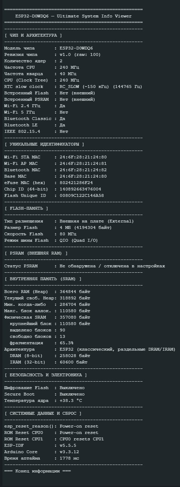
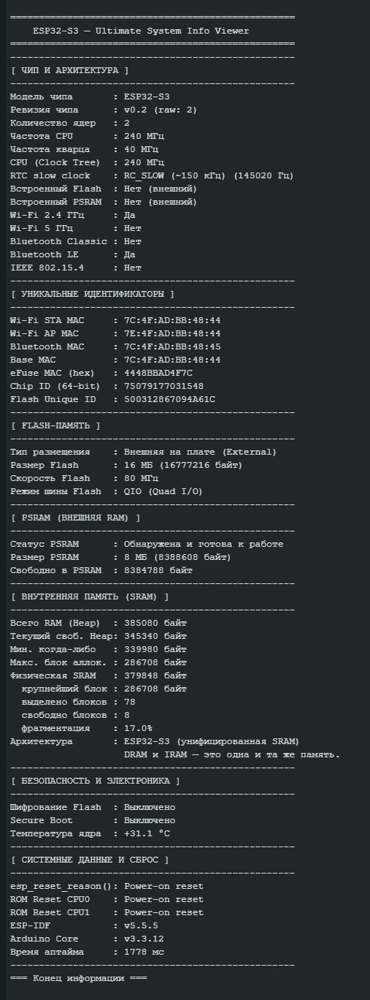

# ESP32 Ultimate System Info Viewer

Кросс-платформенный скетч для Arduino Core 3.3.12 (ESP-IDF v5.5.5).  
Корректно компилируется и работает на всех актуальных чипах ESP32:  
ESP32, ESP32-S2, ESP32-S3, ESP32-C3, ESP32-C5, ESP32-C6, ESP32-P4, ESP32-H2.

Что скетч выводит в монитор порта после заливки:
- Модель, ревизию, количество ядер, частоты
- Источник тактирования CPU, частоту кварца, RTC slow clock
- Уникальные идентификаторы (MAC-адреса, eFuse, Flash UID)
- Характеристики Flash-памяти и внешней PSRAM
- Состояние внутренней SRAM с оценкой фрагментации
- Температуру ядра
- Детальную причину последнего сброса для каждого ядра
- Версии ESP-IDF и Arduino Core

   
